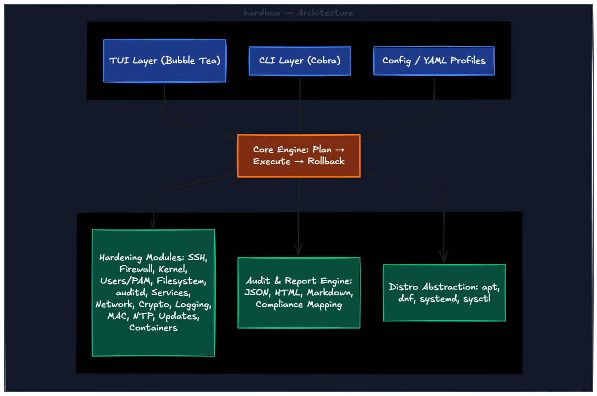

<div align="center">

**Audit your Linux server, then fix it. Free, on your own rules.**

[](https://github.com/jackby03/hardbox/releases)
[](LICENSE)
[](go.mod)
[](https://github.com/jackby03/hardbox/actions)
[](CONTRIBUTING.md)

</div>

---

## What is hardbox?

**hardbox** audits a Linux server against a hardening baseline **and remediates it** — from the command line, for free, and against rules you control.

Most hardening tools tell you what is wrong. hardbox also fixes it: preview every change with `--dry-run`, take a snapshot, apply, and roll back with one command if anything breaks. Audit and remediation are both open source; there is no paid tier.

**21 hardening modules · 199 checks · 12 compliance profiles · 6 distributions verified in CI**

---

## Quick Start

```bash
# Clone and build (requires Go 1.22+)
git clone https://github.com/jackby03/hardbox
cd hardbox
go build -o hardbox ./cmd/hardbox
sudo mv hardbox /usr/local/bin/

# Audit — no changes made
sudo hardbox audit --profile cis-level1 --format html -o audit.html

# Preview changes before applying
sudo hardbox apply --profile production --dry-run

# Apply hardening with rollback safety
sudo hardbox apply --profile production
# Undo the last session (restores file and sysctl state)
sudo hardbox rollback apply --last

# CI / headless mode
sudo hardbox apply --config /etc/hardbox/config.yaml --non-interactive

# Compare two audit reports, fail on regressions
hardbox diff before.json after.json
```

See the full command reference: `hardbox --help`

---

## Features

| Category | Capabilities |
|---|---|
| **Remediation** | Preview with `--dry-run`, atomic writes, pre-apply snapshot of every file a change declares, one-command rollback of file and sysctl state — free and in the same binary as the audit. Package and service changes are forward-only; see [`docs/ARCHITECTURE.md`](docs/ARCHITECTURE.md#what-rollback-does-not-cover) |
| **Hardening** | 21 modules: SSH, firewall, kernel, users, filesystem, auditd, crypto, AppArmor/SELinux, NTP, updates, containers, boot, storage, integrity, malware, shells, processes, and more |
| **Compliance** | 12 built-in profiles: `cis-level1`, `cis-level2`, `pci-dss`, `stig`, `hipaa`, `nist-800-53`, `iso27001`, `cloud-aws`, `cloud-gcp`, `cloud-azure`, `production`, `development` |
| **Reports** | JSON, HTML, Markdown, Text, SARIF — CI/CD-friendly and human-readable |
| **Safety** | Dry-run mode, atomic file writes, snapshot/restore, every failed module surfaced as a partial audit instead of being hidden |
| **Operations** *(add-ons)* | `hardbox watch` scheduled re-audit, `hardbox fleet` multi-host over SSH, `hardbox serve` local report dashboard, `hardbox diff` regression comparison |
| **Integrations** *(add-ons)* | Ansible role, Terraform provider, cloud-init templates, Slack/HTTP webhook alerts |
| **Extensibility** | Plugin SDK for custom modules, YAML-based profiles with `extends` inheritance |
| **Platforms** | Audited in CI on Ubuntu, Debian, RHEL, Rocky Linux, AlmaLinux, Amazon Linux and Fedora. Remediation is currently verified on Debian only — closing that gap is the v0.7 priority, see [`docs/ROADMAP.md`](docs/ROADMAP.md) |

> Full module reference: [`docs/MODULES.md`](docs/MODULES.md) | Compliance mappings: [`docs/COMPLIANCE.md`](docs/COMPLIANCE.md)

---

## Architecture

<div align="center">
  
</div>

---

## Roadmap

| Version | Focus |
|---|---|
| v0.4 ✅ | Core engine, 15 modules, 12 profiles, fleet, diff, serve, plugin SDK |
| v0.5 ✅ | Watch daemon, alerts, SARIF export, profile inheritance, trend sparklines |
| v0.6 ✅ | 6 new modules (boot, storage, integrity, malware, shells, processes) — 21 total |
| **v0.7** | **Remediation parity** (distro-aware package handling, no audit-only silent gaps, `apply` verified in CI) **then** `webserver`, `databases`, `nameservices` |
| v0.8 | Custom hardening: YAML custom checks, Plugin SDK v1, packages |
| v1.0 | Quality bar: remediation verified on every supported distro, no undocumented check |

[`docs/ROADMAP.md`](docs/ROADMAP.md) is the source of truth. It also lists what hardbox deliberately is **not** — no SaaS, no fleet control plane, no desktop hardening, no TUI — so scope decisions have something to point at.

---

## Operations

| Resource | Link |
|---|---|
| Contributing | [`CONTRIBUTING.md`](CONTRIBUTING.md) |
| Module development | [`docs/MODULES.md`](docs/MODULES.md) |
| Integrations (Ansible, Terraform, cloud-init) | [`docs/INTEGRATIONS.md`](docs/INTEGRATIONS.md) |
| Watch daemon | [`docs/WATCH.md`](docs/WATCH.md) |
| Web dashboard | [`docs/SERVE.md`](docs/SERVE.md) |
| DevSecOps & CI | [`docs/DEVSECOPS.md`](docs/DEVSECOPS.md) |
| Changelog | [`CHANGELOG.md`](CHANGELOG.md) |

---

## Contributing

```bash
git clone https://github.com/jackby03/hardbox
cd hardbox
go mod download && go build ./...
```

PRs welcome. See [`CONTRIBUTING.md`](CONTRIBUTING.md) and our [Code of Conduct](CODE_OF_CONDUCT.md).

---

## License

hardbox is free software licensed under [AGPL v3](LICENSE).  
For commercial use without AGPL obligations: jackby03@protonmail.com

---

<div align="center">

**Built for engineers who know that security is not a feature — it's a foundation.**

Audit is table stakes. Fixing is the product.

</div>
